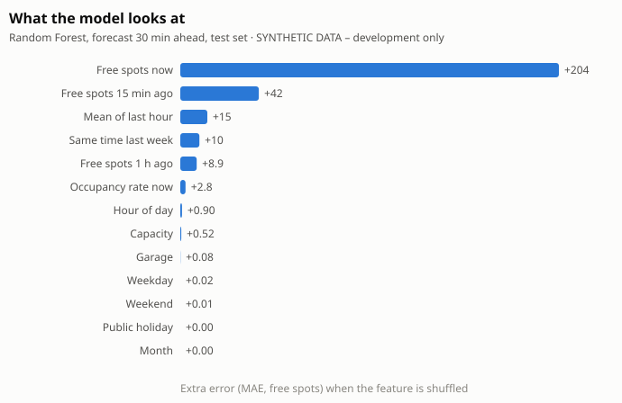

# Occupancy model - evaluation

- Target: free spaces **60 min** ahead, per garage (regression)
- Data: real, 37 garages, one row per garage per 15 minutes
- Features: free, hour, weekday, garage_id, capacity
- Split by time (no shuffling):
  - Train: 2025-11-22 to 2026-10-25, 833,064 rows
  - Validation: 2026-10-25 to 2026-11-08, 49,580 rows
  - Test: 2026-11-08 to 2026-11-22, 46,309 rows
- Trained: 2026-11-25T15:08:24+00:00

## Comparison on the validation set (MAE in spaces, lower is better)

| Model | Train MAE | Validation MAE |
|---|---:|---:|
| k-NN (k=20) | 4.74 | 7.76 |
| k-NN (k=5) | 4.02 | 7.99 |
| Random forest (depth 12) | 5.88 | 8.34 |
| Decision tree (depth 12) | 6.30 | 8.87 |
| Gradient boosting | 8.73 | 10.29 |
| Random forest (depth 8) | 8.26 | 10.52 |
| Decision tree (depth 8) | 8.61 | 10.97 |
| Linear regression | 9.85 | 11.50 |
| Decision tree (depth 5) | 11.41 | 13.09 |
| Baseline: same as now | 8.72 | 10.50 |

## Final result on the test set (used once, best model only)

| | Test MAE |
|---|---:|
| **k-NN (k=20)** | **7.24** |
| Baseline: same as now | 9.98 |

The model is off by 7.2 spaces on average, the baseline by 10.0.

## Feature importance

How much larger the MAE gets on the validation set when a feature is shuffled.

| Feature | Extra MAE when shuffled |
|---|---:|
| Free spaces now | +109 |
| Capacity | +31 |
| Hour of day | +8.6 |
| Garage | +8.0 |
| Weekday | +2.2 |
